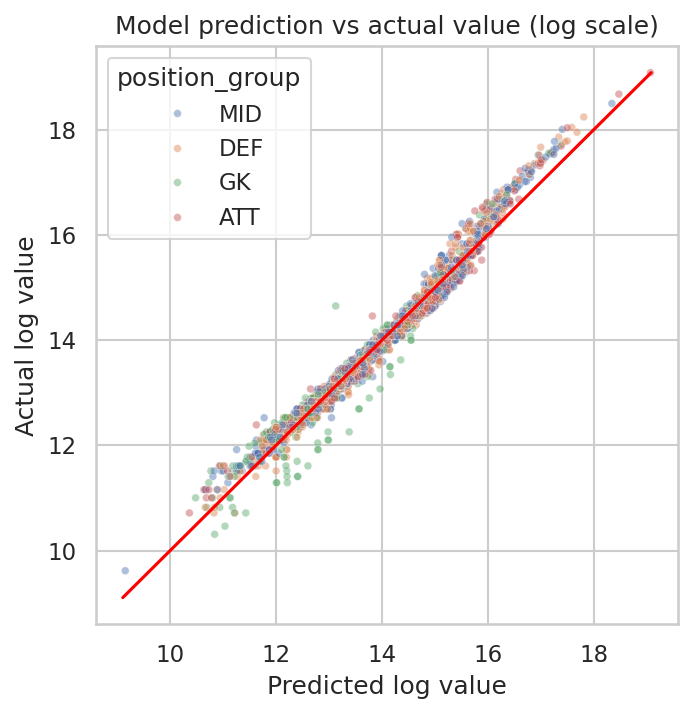
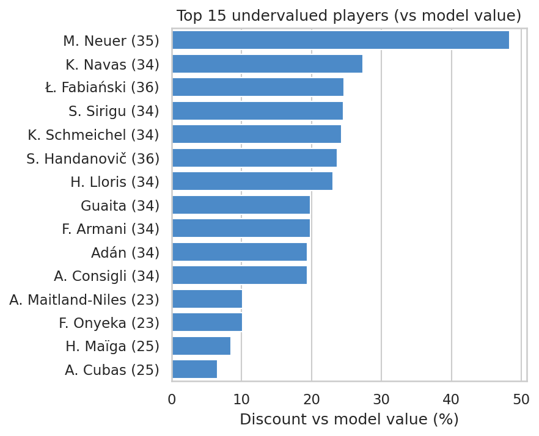
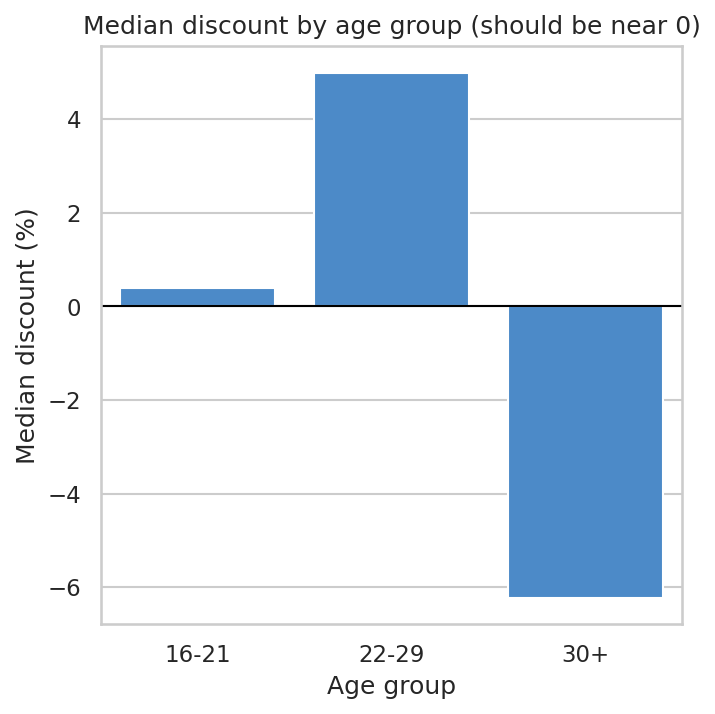
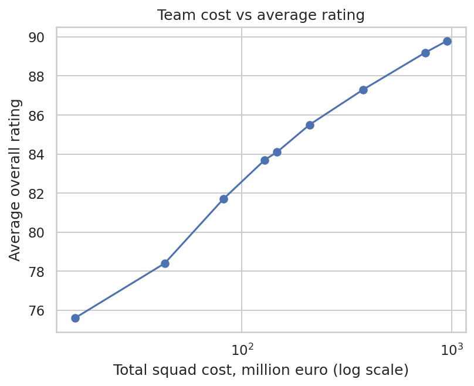

# FIFA Moneyball: Finding Undervalued Players (Python + SQL)

In this project I used data from FIFA 22 to answer one question: **how much should a player be worth, and which players cost less than they should?** I cleaned the data with pandas, explored it with charts and SQL, built a small price model with NumPy, and used it to find undervalued players and a cheap "Budget XI" team.

**Main results**
- A player's value grows by about **17% for every extra rating point**.
- A model using rating, age, potential and position explains most of the price differences (R² of 0.97, compared with 0.79 for rating alone).
- A 4-3-3 team with no price limit costs **952M** and averages **89.8** rating. A team where no player costs more than 10M costs **81.6M** (about 91% less) and averages **81.7**. It is much older though: average age 36.3 against 30.6.

## Dataset

[FIFA 22 complete player dataset](https://www.kaggle.com/stefanoleone992/fifa-22-complete-player-dataset) by Stefano Leone on Kaggle. I used the `players_22.csv` file (19,239 players, 110 columns) and kept 9 columns: name, age, club, league, positions, overall, potential, value and wage. The raw file is not uploaded here, so please download it from Kaggle.

## Tools

- Python: pandas, NumPy
- matplotlib and seaborn for charts
- SQL (SQLite) for queries, run from Python
- Google Colab

## What I did

1. **Looked at the data.** There were 74 players with no value, no players with value 0, and no duplicates.
2. **Cleaned it.** I removed the 74 players with no value (19,165 left) and created new columns:
   - `main_position` and `position_group` (GK, DEF, MID, ATT)
   - `age_group` (16-21, 22-29, 30+)
   - `gap` (potential minus overall) and `value_m` (value in million euro)
3. **Explored it** with charts, correlations and group summaries.
4. **Used SQL** for group summaries, club squad values, and window functions (`row_number` with `partition by`, and a window average).
5. **Built a price model** with NumPy and used it to find undervalued players.
6. **Picked a Budget XI** and checked how rating changes as the price limit goes up.

## What I found

**Exploring the data**
- Players of the same rating can have different values. The average rating is about 66 for attackers, midfielders and defenders, but the average value is 3.45M for attackers, 3.11M for midfielders, 2.53M for defenders and 1.93M for goalkeepers. So the position changes the price too.
- The gap between potential and overall gets smaller as players get older.
- Value rises very fast with rating, so I used a log scale to see the pattern.
- Manchester City has the highest squad value in the data (1,299.5M), followed by Paris Saint-Germain (1,227.4M) and Liverpool (1,046.4M).

**The price model**
- Model 1 uses only the rating (on log value). Each extra rating point raises the value by about 17%. R² is 0.79.
- Model 2 adds age, age squared, the potential gap and position. R² goes to 0.97.
- For each player I calculated a "fair value" from the model and the discount between the real value and the fair value.

**Undervalued players** (rating 75 or more, value 3M or more)
- The top of the list is mostly older goalkeepers: Neuer (13.5M against a model value of 26.2M), Navas, Fabiański, Sirigu, Schmeichel, Handanovič and Lloris.
- After them come younger midfielders and defenders, such as Maitland-Niles and Onyeka, with discounts of about 8-10%.

**Is the model fair for every age?**
The median discount should be near 0 for all age groups. It is close for the 16-21 group, but about +5% for ages 22-29 and about -6% for 30+. So a small age bias is left in the model.

**Budget XI** (4-3-3, no single player above the price limit)

| Team | Total cost | Average rating | Average age |
|---|---|---|---|
| Dream XI (no limit) | 952.0M | 89.8 | 30.6 |
| Budget XI (10M per player) | 81.6M | 81.7 | 36.3 |

The Budget XI includes players like Handanovič, Thiago Silva, Pepe, Fernandinho and Payet. Paying more gives less and less extra rating: with a 10M limit the team costs 81.6M and averages 81.7, but with a 100M limit it costs 749.5M for 89.2.

## Limits of this project

- FIFA values come from the game, not from the real transfer market. The model partly learns how the game sets prices, so "undervalued" only means cheaper than **this model** says.
- The model only knows rating, age, potential and position. It does not know contracts, injuries or club needs.
- Goalkeepers dominate the undervalued list. A likely reason is that the model uses one age curve for all positions, while goalkeepers play well for longer. A model with a separate age curve for goalkeepers would be a good next step.
- I checked R² on the same data the model learned from. A proper train and test split would be better.
- The Budget XI is old (average age 36.3). It is cheap because older players are valued low, which is not the same as being a real bargain for a club.

## Files

| File | What it is |
|---|---|
| `fifa_moneyball.ipynb` | The full notebook (cleaning, charts, SQL, model, Budget XI) |
| `chart1_model_fit.png` to `chart4_cost_vs_rating.png` | Charts used above |

## How to run it

1. Download `players_22.csv` from the Kaggle link above.
2. Open `fifa_moneyball.ipynb` in Google Colab and upload `players_22.csv` in the Files panel.
3. Run the cells from top to bottom.

---
Made by Rhythem Dubey
